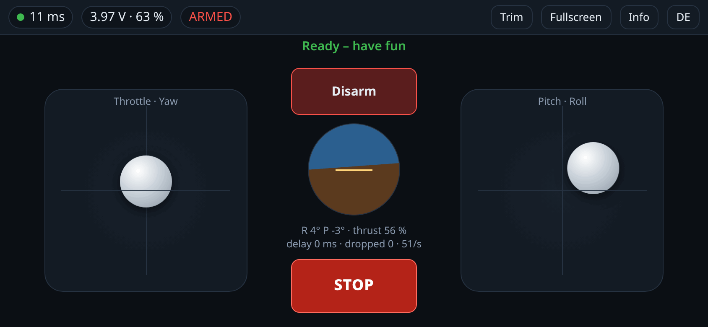
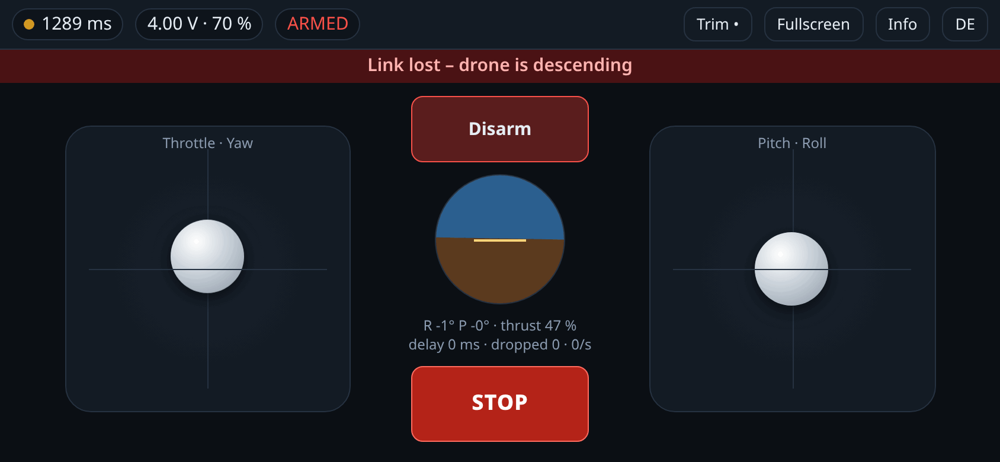
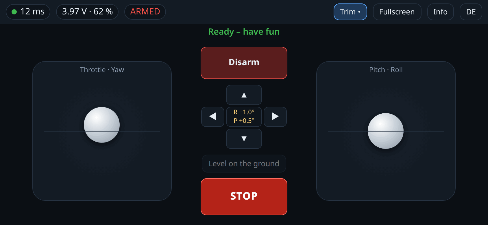
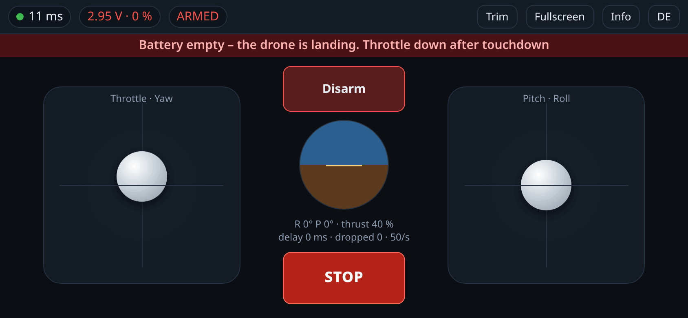
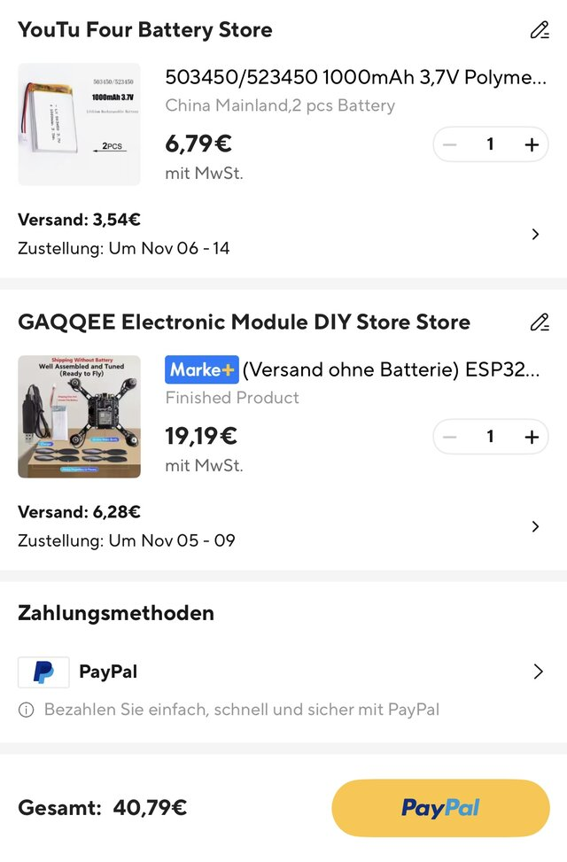

## This fork: ESP-Drone with browser control

[](https://github.com/TechnikWeber/esp-drone/actions/workflows/build_project.yml?query=branch%3Awebcontrol)

Fly the drone from any phone browser: join the drone's Wi-Fi and the control
page opens by itself (captive portal). No app, no account, no internet.

**Install:** one click in the [web flasher](https://technikweber.github.io/esp-drone/)
(Chrome or Edge on a computer), or download an image from the
[releases](https://github.com/TechnikWeber/esp-drone/releases). All ways, including
Espressif's own tools: [docs/flashing.md](docs/flashing.md). **First steps,** from the
box to the first hover: [docs/getting-started.md](docs/getting-started.md).

<table>
  <tr>
    <td width="50%"></td>
    <td width="50%"></td>
  </tr>
  <tr>
    <td><b>Flying.</b> Round trip time, battery, attitude, thrust and dropped late commands at a glance.</td>
    <td><b>Link lost.</b> The drone holds the last command for 0.3 s, then levels out, descends and turns the motors off.</td>
  </tr>
  <tr>
    <td></td>
    <td></td>
  </tr>
  <tr>
    <td><b>Trim.</b> Level the drone on the ground with one tap, correct a drift in 0.5° steps; the drone stores it.</td>
    <td><b>Empty battery.</b> The drone lands by itself while you keep steering.</td>
  </tr>
</table>


What this fork adds to [espressif/esp-drone](https://github.com/espressif/esp-drone)
(based on `master@9d5a4f8` of 26 Oct 2026; changes since 25 Oct 2026 by Philipp
Weber, [TechnikWeber](https://github.com/TechnikWeber)):

- **Browser control over Wi-Fi with a robust link.** A WebSocket instead of UDP,
  with TCP's weak spots handled: only the newest command counts, commands that
  arrive late after a stall are dropped, and a staged failsafe takes over when
  commands stop coming. The web server runs in its own tasks (on the ESP32 on
  the other CPU core), so a page reload cannot stall the flight controller. The
  page speaks English and German. See [docs/webcontrol.md](docs/webcontrol.md).
- **Battery protection and trim** for web flights: forced landing below 3.0 V,
  no arming below 3.4 V, roll and pitch trim stored on the drone.
- **New board: E1 Mini** (pictured), a mini quadcopter kit with a plug-in
  ESP32 DevKit and an MPU6500 on SPI. Sellers use many brand names; "ESP32
  Drone" and "E1" or "E1 Mini" are in almost every listing. Its open hardware
  design, the origin of these kits, is the
  [E1 Mini project on OSHWHub](https://oshwhub.com/songge8/project_qqqyfdkm) by
  songge8 (CC BY-NC-SA 4.0; schematic and PCB in [hardware/E1_Mini](hardware/E1_Mini/)).
  Pins and controller gains checked against its
  schematic and the vendor firmware (CF-Drone). See [docs/e1-mini.md](docs/e1-mini.md).
- **Arming by exactly one source:** web pilot, app/cfclient/ESP-NOW (throttle to
  zero once) or `system.forceArm`. Every connected phone can trigger STOP.
- Partition table with two app slots and a core dump partition.

**Parts ordered for the E1 Mini** (October 2026, about 41 € with shipping):

<table>
  <tr>
    <td width="260"></td>
    <td>
      <a href="https://www.aliexpress.com/item/1005013106847900.html"><b>Drone kit</b></a>: "ESP32 Drone"
      E1 Mini, variant "Finished Product", shipped without battery.<br><br>
      <a href="https://www.aliexpress.com/item/1005004375261361.html"><b>Batteries</b></a>: 2 × 1S LiPo
      1000 mAh, type 503450 (50 × 34 × 5 mm), PH2.0 plug. Recommended in a forum, not tested here
      yet. What a battery has to meet: <a href="docs/e1-mini.md#battery">docs/e1-mini.md</a>.
    </td>
  </tr>
</table>

All boards of the original are kept. GitHub Actions builds every change with
ESP-IDF 5.5 and 6.1: ESP32 (E1 Mini), ESP32-S2 and -S3 (ESP32-S2-Drone), ESP32-P4
(without web control, the P4 has no Wi-Fi of its own) and ESP32-S31 (preview).
ESPlane (ESP32) was built locally with 5.5. **Nothing has been tested on real
hardware yet;** the screenshots come from the simulated drone in
`tools/mock_drone.py`. RAM on the ESP32-S2 is tight: the core dump is off there
and the SPI interrupt handler is not in IRAM; a test has to show whether the heap
is enough for web control.

License unchanged: **GPL-3.0** (see [LICENSE](LICENSE)). Copyright of the
original parts: Espressif Systems and Bitcraze AB. Exception: the E1 Mini
schematic and PCB in [hardware/E1_Mini](hardware/E1_Mini/) are by songge8 under
CC BY-NC-SA 4.0 (non-commercial).

```bash
. ~/esp/esp-idf-v5.5.6/export.sh
idf.py set-target esp32       # E1 Mini; esp32s2/esp32s3 for the ESP32-S2-Drone,
                              # pick the board in idf.py menuconfig
idf.py build && idf.py -p /dev/ttyUSB0 flash monitor
```

---

## ESP-Drone

* [中文](./README_cn.md)

[](https://github.com/espressif/esp-drone/actions/workflows/build_project.yml)

### Introduction

**ESP-Drone** is an open-source drone solution for Espressif SoCs. The flight hardware can be controlled by a mobile app or gamepad over **Wi-Fi**. ESP-Drone has **simple hardware** and an extensible architecture, making it suitable for **STEAM education** and prototyping. The flight-control core is derived from the **Crazyflie** open-source project and is licensed under GPL-3.0.

> Supported ESP-IDF branches are [release/v5.5](https://docs.espressif.com/projects/esp-idf/en/release-v5.5/esp32s2/get-started/index.html) and `release/v6.1` only. ESP32-S31 requires the 6.1 preview target. ESP32-P4 currently uses a no-radio diagnostic profile, and P4/S31 flight hardware still requires board-specific pin maps and validation.


For more information, please check the sections below:
* **Getting Started**: [Getting Started](https://docs.espressif.com/projects/espressif-esp-drone/zh_CN/latest/gettingstarted.html)
* **Hardware Schematic**：[Hardware](https://docs.espressif.com/projects/espressif-esp-drone/zh_CN/latest/_static/ESP32_S2_Drone_V1_2/SCH_Mainboard_ESP32_S2_Drone_V1_2.pdf)
* **iOS APP Source code**: [ESP-Drone-iOS](https://github.com/EspressifApps/ESP-Drone-iOS)
* **Android APP Source code**: [ESP-Drone-Android](https://github.com/EspressifApps/ESP-Drone-Android)

### Features

1. Stabilize Mode
2. Height-hold Mode
3. Position-hold Mode
4. APP Control
5. cfclient support; see https://github.com/leeebo/crazyflie-clients-python
6. ESP-BOX-3 joystick control through ESP-NOW

Note: to implement Height-hold/Position-hold mode, extension boards are needed. For more information, see Hardware Reference. 

### Third Party Copyrighted Code

Additional third party copyrighted code is included under the following licenses.

| Component | License | Origin |Commit ID |
| :---:  | :---: | :---: |:---: |
| core/crazyflie | GPL3.0  |[Crazyflie](https://github.com/bitcraze/crazyflie-firmware/tree/2021.01) |tag_2021_01 b448553|
| lib/dsp_lib |  | [esp32-lin](https://github.com/whyengineer/esp32-lin/tree/master/components/dsp_lib) |6fa39f4c|

### Support Policy

From December 2022, we will offer limited support on this project, but Pull Request is still welcomed!

### THANKS

1. Thanks to Bitcraze for the great [Crazyflie project](https://www.bitcraze.io/).
2. Thanks to Espressif for the powerful [ESP-IDF framework](https://docs.espressif.com/projects/esp-idf/en/latest/esp32s2/get-started/index.html).
3. Thanks to WhyEngineer for the useful [ESP-DSP lib](https://github.com/whyengineer/esp32-lin/tree/master/components/dsp_lib).
