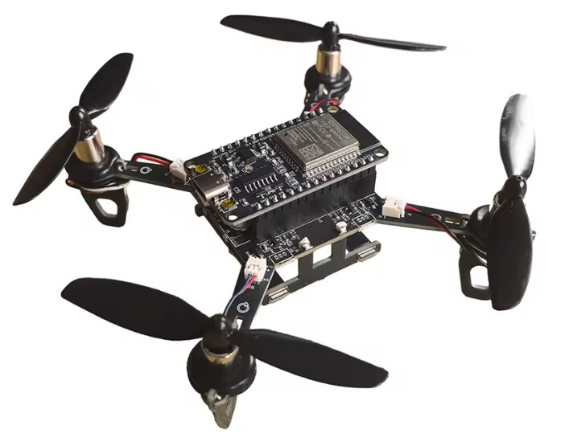

# ESP-Drone on the E1 Mini



This firmware variant runs on the **E1 Mini**, a mini quadcopter kit with a
plug-in ESP32 DevKit (open hardware project:
<https://oshwhub.com/songge8/project_qqqyfdkm>). Sellers use many brand names;
"ESP32 Drone" and "E1" or "E1 Mini" are in almost every listing. It ships with
the Arduino firmware *CF-Drone*
([songge8/CF-Drone](https://github.com/songge8/CF-Drone)), which some sellers
rename to "XW-Drone". This guide describes how ESP-Drone was adapted to the
hardware, how to flash it and how to test on the bench before the first flight.

> **Status:** ported from the vendor's documents, **not tested on real hardware
> yet**. The bench checklist below is therefore mandatory.

## Hardware

| Function | Connection | Source |
|---|---|---|
| Controller | ESP32 DevKit V1, 30 pins, classic ESP32 (no S3) | project page, photos |
| IMU | MPU6500 on SPI: SCK GPIO18, MISO GPIO19 (module pin AD0), MOSI GPIO23 (SDA), CS GPIO5 (NCS), **no interrupt** | CF-Drone `board_config.h`, `imu.ino` |
| Motor M1 front right | GPIO15 | CF-Drone `BOARD_MOTOR_PINS` |
| Motor M2 rear right | GPIO13 | |
| Motor M3 rear left | GPIO12 | |
| Motor M4 front left | GPIO14 | |
| Motor drivers | AO3416 MOSFETs, 25 kHz PWM | parts list, CF-Drone `motors.ino` |
| Battery voltage | GPIO36, divider 10 kΩ / 33 kΩ → Vbat = Vadc × 1.303 | CF-Drone `battery.ino` |
| Status LED | GPIO2 (blue LED of the DevKit) | CF-Drone |
| Expansion | I2C SDA 21 / SCL 22, PMW3901 CS GPIO33, VL53L1X XSHUT GPIO32 | CF-Drone |
| Buzzer | none | |

The pin numbers are facts taken from the vendor's files; no CF-Drone code was
copied.

### IMU orientation

ESP-Drone works in the Crazyflie body frame: X forward, Y left, Z up. The vendor
firmware sets `imuRotation = (0, 0, −90°)` and states the mounting in the
comment next to it (`imu.ino`): chip on top, sensor X points right, sensor Y
points forward, converted as `(y, −x, z)`. So:

- sensor Y points forward → body X = sensor Y
- sensor X points right → body Y = −sensor X
- sensor Z points up

In `menuconfig` this is **"270 deg: body X = sensor Y, body Y = −sensor X"**
(`CONFIG_IMU_ROTATION_270`, the default for the E1 Mini). Check it on the bench!

### Motor directions

From the vendor firmware's mixer: **front left and rear right spin clockwise**,
front right and rear left counter-clockwise (seen from above). ESP-Drone's
Crazyflie mixer expects the same, so `MOTOR_YAW_INVERT` is off.

## Changes compared to ESP-Drone

- **New board** `TARGET_E1_MINI` with all pins (`menuconfig` → ESPDrone Config).
- **MPU6500 driver on SPI** (`components/drivers/spi_devices/mpu6500`) and the
  sensor layer `sensors_mpu6500_spi.c`. Without an interrupt line, a hardware
  timer provides the 1 kHz sample clock. Sensor and stabilizer tasks run on CPU
  core 1, Wi-Fi and the web servers on core 0.
- **Shared SPI bus** for the IMU and an optional flow sensor (`spi_bus`).
- **Motor PWM** 25 kHz / 10 bit; the motor pins are pulled low right at boot.
  Espressif switched the short motor test at startup (`MOTORS_STARTUP_TEST`) off
  by default; turn it on for the bench test.
- **Starts disarmed.** Arming by exactly one source: web control (button),
  app/cfclient/ESP-NOW (throttle to zero once) or the parameter
  `system.forceArm`.
- **Brownout reset off**, as in the vendor firmware: the 3.3 V supply dips
  briefly when the motors spin up, and a reset in the air would be worse.
- **Partition table** for 4 MB with two app slots (later updates over Wi-Fi)
  and a core dump partition.
- **Controller gains** for roll and pitch taken from the vendor firmware
  (converted, see "First flight").
- **Browser control with captive portal**, battery protection and trim, see
  [webcontrol.md](webcontrol.md).

## Set up the tools

ESP-IDF **v5.5** (here v5.5.6 with Python 3.14 on Fedora 44). v6.1 works too;
GitHub Actions builds every change with both versions:

```bash
git clone -b v5.5.6 --depth 1 --recursive --shallow-submodules \
    https://github.com/espressif/esp-idf.git ~/esp/esp-idf-v5.5.6
~/esp/esp-idf-v5.5.6/install.sh esp32
. ~/esp/esp-idf-v5.5.6/export.sh
```

On Fedora, access to the DevKit's USB serial adapter (`/dev/ttyUSB0`) needs the
group `dialout`:

```bash
sudo usermod -aG dialout $USER     # then log out and back in
```

## Try the factory firmware first

Before you change anything: if the drone flies with the factory firmware, the
hardware is fine, and you have something to compare with later.

- **Phone control out of the box:** Wi-Fi `Drone_WiFi`, password `12345678`,
  then open `http://192.168.4.1` in the browser (the page does not open by
  itself).
- **Serial console**, propellers off:

  ```bash
  . ~/esp/esp-idf-v5.5.6/export.sh
  python -m serial.tools.miniterm --eol LF /dev/ttyUSB0 115200   # quit: Ctrl+]
  ```

  - `imu` shows the IMU; expected: `model: MPU-6500` and `who am I: 0x70`
  - `mfl`, `mfr`, `mrl`, `mrr` run one motor at 30 % for 3 s (front left, front
    right, rear left, rear right). Check: correct position, **front left and
    rear right spin clockwise**, the other two counter-clockwise (seen from
    above).

The seller offers the factory firmware image (`XW-Drone.ino.merged.bin`) only
on Baidu (account needed). The easiest way back is your own backup from the
next step.

## Back up the factory firmware (before the first flash!)

The factory firmware is tuned for the drone. Back up the whole flash, then you
can always go back. **Remove the propellers first.**

```bash
. ~/esp/esp-idf-v5.5.6/export.sh
esptool.py --port /dev/ttyUSB0 chip_id          # must report "ESP32"
esptool.py --port /dev/ttyUSB0 flash_id         # shows the flash size (4 MB expected)
esptool.py --port /dev/ttyUSB0 -b 921600 read_flash 0 ALL e1mini-factory.bin
```

The file must be as large as the flash (4 MB = 4194304 bytes). To restore:

```bash
esptool.py --port /dev/ttyUSB0 -b 921600 write_flash 0 e1mini-factory.bin
```

## Build and flash

```bash
. ~/esp/esp-idf-v5.5.6/export.sh
idf.py set-target esp32        # selects the E1 Mini board automatically
idf.py build
idf.py -p /dev/ttyUSB0 flash monitor
```

Settings (pins, failsafe times, Wi-Fi name and password) in `idf.py menuconfig`
→ *ESPDrone Config* and *ESPDrone web control*.

## Bench checklist — WITHOUT propellers

Every item has to pass before the propellers go on.

1. **Boot log** (`idf.py monitor`):
   - `MPU6500 SPI connection [OK], WHO_AM_I = 0x70` (0x71/0x73 for MPU9250 variants)
   - `IMU sample timer running at 1000 Hz on core 1`
   - `web control ready: http://192.168.43.42/`
   - no reset, no `assert`; the LED blinks in the "alive" pattern
2. **Motor order:** in `menuconfig` → *motors config*, turn on "Spin motors
   during startup self-test" (off by default) and flash again. At boot the
   motors then spin briefly one after the other: M1 front right → M2 rear right
   → M3 rear left → M4 front left. If a position is wrong, swap the pins in
   `menuconfig` → *motors config*. Turn the option off again afterwards.
3. **Attitude:** join the Wi-Fi `ESP-DRONE_…` with a phone (password
   `12345678`); the control page opens. Put the drone down flat and keep it
   still until "Calibrating – keep the drone still" disappears and "Arm" can be
   pressed. Then:
   - tilt the nose down → **P goes negative**
   - tilt the right side down → **R goes positive**
   - If a sign or an axis is wrong: change `IMU_ROTATION` in `menuconfig`.
4. **Counter-steering (the most important test):** hold the drone in your
   hand, throttle down, arm, throttle to about 20 %:
   - tilt it right side down → the **right** motors get audibly faster
   - tilt the nose down → the **front** motors get faster
   - turn it clockwise → **front left and rear right** get faster
   - If the wrong motors react: **do not fly**; check the IMU orientation and
     `MOTOR_YAW_INVERT`.
5. **Failsafe:** armed, throttle at 30 %, then switch off Wi-Fi on the phone.
   After 0.3 s the motors even out (levelling out), after 1 s they get quieter
   (descending), after 4 s they stop. The log shows `link failsafe: stage …`
   and `disarmed: link lost …`.
6. **STOP:** armed, throttle at 30 %, tap STOP → the motors stop at once.
7. **Battery:** compare the voltage on the page with a multimeter at the
   battery. If they differ, adjust `BATTERY_DIVIDER_X1000`. Note: above about
   4.05 V the ESP32 ADC cannot measure accurately because of the divider.
   Below 3.4 V the drone cannot be armed; in flight it lands by itself below
   3.0 V (see [webcontrol.md](webcontrol.md#battery-protection)).

## First flight

- Small, open room, nobody nearby, prop guards on.
- Propellers as from the factory (mind the direction), battery full.
- Put the drone down level and keep it still until the calibration is done.
- Arm and raise the throttle slowly. If it tips over or spins away on takeoff:
  **STOP** at once.
- Controller gains: for roll and pitch the E1 Mini uses the vendor firmware's
  rate gains, converted to ESP-Drone units: P 137, I 229, D 2.3 instead of the
  Crazyflie values 250/500/2.5. Conversion: value × 2 · 65535 / 57.3, because
  the ESP-Drone mixer halves roll and pitch. Yaw (P 120) and the attitude loop
  (P 5.9) stay at the ESP-Drone defaults. The vendor firmware uses about P 343
  for yaw, but relies on motor desaturation that the ESP-Drone mixer does not
  have. If the E1 Mini oscillates or turns sluggishly around the vertical axis,
  adjust the parameters `pid_rate.*` and `pid_attitude.*` carefully with
  cfclient (UDP).
- If it drifts steadily to one side while hovering, correct it with "Trim" on
  the control page (see [webcontrol.md](webcontrol.md#trim)).
