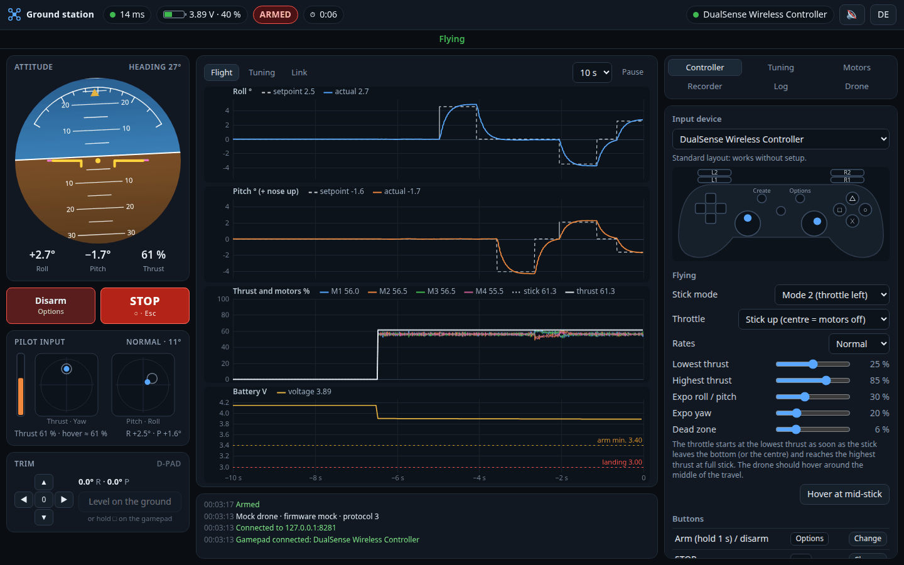
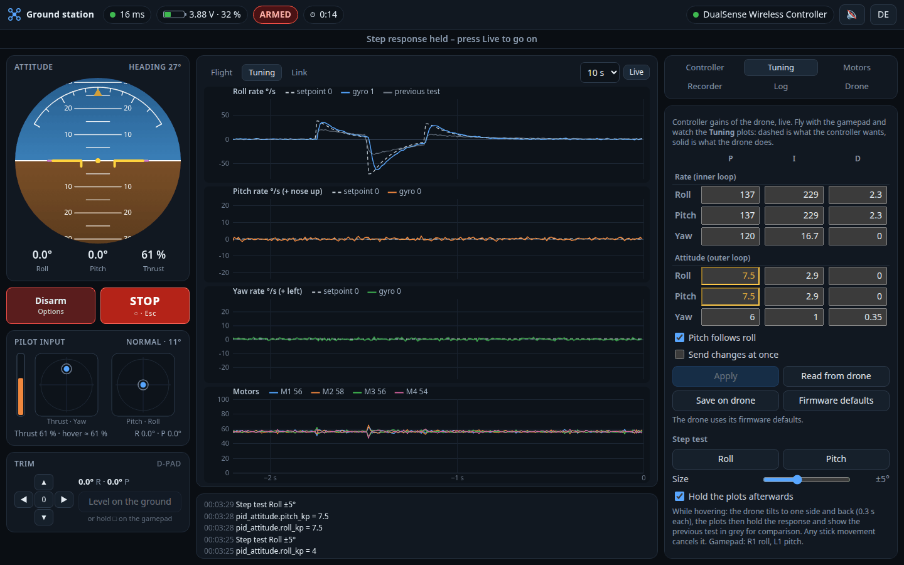
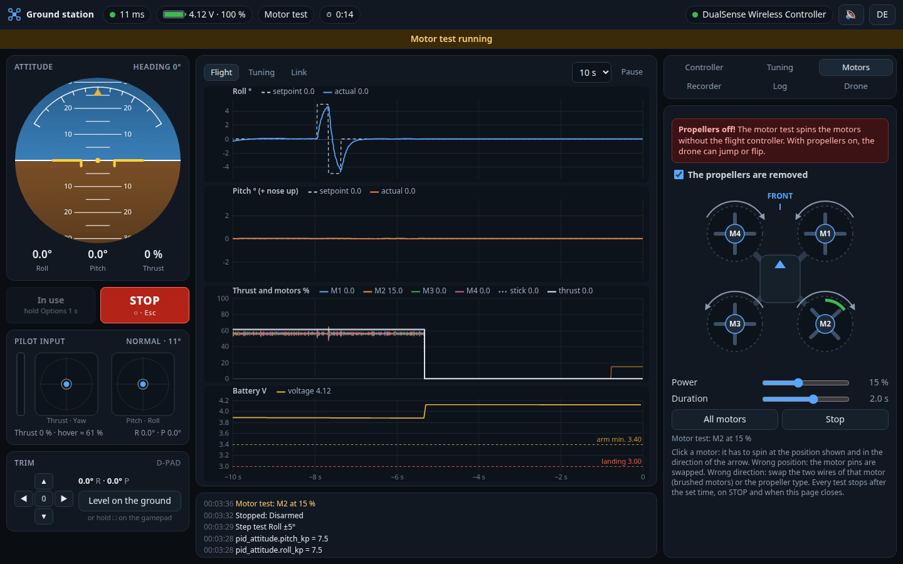
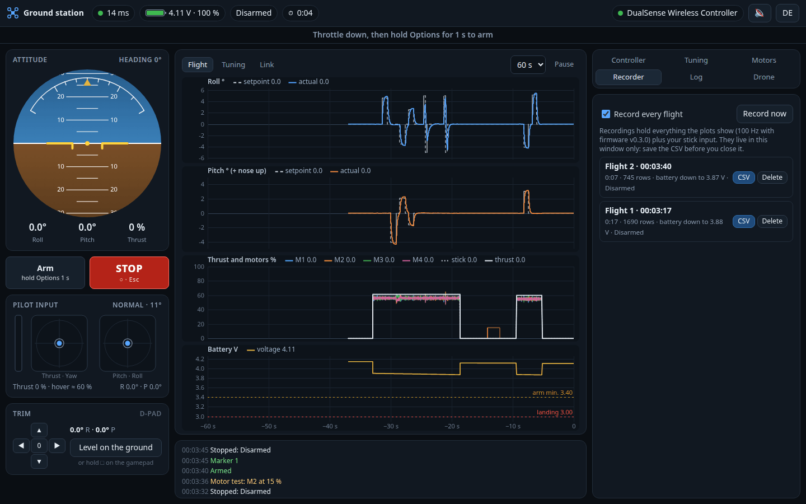

# Desktop ground station

A ground station for the computer: fly with a gamepad, watch the flight
controller live, tune the controller gains, test the motors on the bench and
record every flight. It talks to the same firmware and the same WebSocket as the
phone page ([webcontrol.md](webcontrol.md)); the phone page keeps working, and
both can be connected at the same time (one flies, the other watches).

> **Not tested on real hardware or with real gamepads yet.** Everything below
> was tested against the simulated drone (`tools/mock_drone.py`) with a
> simulated DualSense controller in Chrome.

## What it adds to the phone page

| | Phone page | Ground station |
|---|---|---|
| Sticks | touch | gamepad (PlayStation 3/4/5, Xbox, Switch Pro, most others), RC transmitter over USB, keyboard |
| Feedback | vibration of the phone | rumble of the gamepad, warning tones, voice announcements |
| Telemetry | attitude, battery, link | live plots at 100 Hz: setpoint and actual attitude, rates, motor outputs, thrust, battery, link |
| Controller gains | fixed in the firmware | read, change in flight, store on the drone, back to the defaults |
| Tuning help | – | step test that holds the response and shows the previous test for comparison |
| Bench test | arm and feel with the hand | motor test: each motor alone, position and direction shown |
| Records | – | every flight at 100 Hz, CSV export, event log |

The 100 Hz samples, the gains and the motor test need firmware **v0.3.0** or
newer (protocol 3). With older firmware the ground station flies and shows the
attitude, battery and link, and says what is missing.

## Starting it

The ground station is one file, [tools/groundstation/index.html](../tools/groundstation/index.html),
with no external dependencies, so it works without internet (the drone's Wi-Fi
has none). Browsers allow gamepads only on secure pages: `http://localhost` and
local files count as secure, the drone's own page `http://192.168.43.42` does
not. That is why the phone page cannot use gamepads.

1. Join the drone's Wi-Fi `ESP-DRONE_…` (password `12345678`) with the computer.
2. Start the ground station, one of:
   - `python3 tools/groundstation/groundstation.py` – serves the page on
     `http://localhost:8090` and opens the browser (Python 3, no packages).
   - Open `index.html` directly in **Chrome or Edge** (double click, or drag it
     into the window). The release page also has it as `esp-drone-groundstation.html`.
3. Connect the gamepad (USB or Bluetooth) and **press any button**: browsers
   only report a gamepad after a button press.

The page connects to `192.168.43.42` and keeps retrying; another address can
be set in the *Drone* panel or with `?host=` (`groundstation.py --drone`).
Chrome and Edge are recommended. Firefox works for flying, but has no gamepad
rumble.

**Trying it without a drone:** `python3 tools/mock_drone.py` starts a
simulated drone, then `python3 tools/groundstation/groundstation.py --drone 127.0.0.1:8081`.
The simulation runs the same cascaded PID as the firmware with motor and sensor
delay, so changed gains change the response.

## Gamepads

Gamepads with the browser's *standard layout* work without setup. Chrome and
Edge know PlayStation 3, 4 and 5, Xbox 360/One/Series, the Switch Pro
controller and many others; the *Controller* panel says "Standard layout" for
them. Buttons are named after the controller (✕ ○ □ △ for PlayStation,
A B X Y for Xbox and Switch).

Default buttons (Mode 2):

| Function | PlayStation | Xbox | Switch Pro |
|---|---|---|---|
| Throttle, yaw | left stick | left stick | left stick |
| Pitch, roll | right stick | right stick | right stick |
| **Arm**: hold 1 s, throttle down | Options (PS3: Start) | Menu | + |
| Disarm (throttle down) | Options | Menu | + |
| **STOP**: motors off at once | ○ | B | A |
| Trim (0.5° per press) | D-pad | D-pad | D-pad |
| Rates: beginner → normal → sport | △ | Y | X |
| Level on the ground: hold 1.5 s | □ | X | Y |
| Marker in the recording | ✕ | A | B |
| Step test roll / pitch | R1 / L1 | RB / LB | R / L |

`Esc` on the keyboard is STOP as well while the ground station flies or runs a
motor test (when someone else flies, use the STOP button: a stray `Esc` must
not stop their flight). Every button can be changed in the *Controller* panel:
*Change*, then press the new button.

**Throttle.** A gamepad stick springs back to the centre, a real throttle does
not. The default is "stick up": the lower half does nothing, the motors start at
the *lowest thrust* when the stick leaves the centre and reach the *highest
thrust* at full stick. Letting go of the stick turns the motors off. Other
choices: the right trigger, or the full stick travel for a non-centring stick.
After a few seconds of hovering, *Hover at mid-stick* moves the thrust range so
that the drone hovers with the stick halfway up.

**Other controllers.** Gamepads without the standard layout, flight sticks and
RC transmitters in USB joystick mode (EdgeTX, OpenTX) work too: the *Controller*
panel then lists the sticks as well, and each one is assigned by moving it.
For a transmitter, choose "Full stick travel" as throttle.

Also in the panel: stick mode 1 or 2, rates (50, 75 or 100 % of the drone's
maximum angle), expo, dead zone, rumble, tones, voice and keyboard flying.

## Safety

The ground station never leaves the drone with a stale command:

- **Gamepad lost** (battery, Bluetooth): the page stops sending, the drone
  levels out, descends and turns the motors off after the failsafe time. A
  pressed button on the gamepad takes over again. The flight does not switch
  to the keyboard.
- **Window hidden or out of focus**: the same; the focus rule can be switched
  off in the *Controller* panel.
- **Arming** needs the throttle down and a 1 s hold; disarming with the gamepad
  needs the throttle down (STOP always works).
- Warnings come as tones, voice and rumble: arming, link loss, low battery,
  forced landing, lost gamepad. Browsers allow sound only after a first click
  into the page.

## Plots

Three sets, 5 to 60 seconds wide, *Pause* to freeze them; the mouse shows the
values at any moment in all plots.

- **Flight**: roll and pitch, setpoint (dashed) and actual; thrust, the four
  motors and your stick; battery voltage with the landing and arming limits.
- **Tuning**: roll, pitch and yaw rate, setpoint of the rate controller and
  gyro; motor outputs.
- **Link**: round trip time, extra delay of the commands on the drone, commands
  received and dropped per second.

The artificial horizon shows the controller's setpoint as pink bars.

## Tuning the controller

The *Tuning* panel shows the 18 gains of the rate (inner) and attitude (outer)
controllers. Changed values are yellow; *Apply* sends them (or tick "Send
changes at once"), and they take effect immediately, in flight too. In flight
only the pilot may change them. *Save on drone* stores them in the drone's flash
(only on the ground), and they are loaded at every start; *Firmware defaults*
brings everything back and erases the stored values. Erasing the flash with the
web flasher also removes them.

**Step test** (*Roll* / *Pitch* in the panel, R1 / L1 on the gamepad): while
hovering, the drone tilts to one side and back (0.3 s each, size adjustable).
The plots then hold the response, and the previous test of the same axis is
drawn in grey, so the effect of a change is visible right away. Moving the
stick cancels the test.

Rules of thumb:

1. Tune in a calm room, with the trim set.
2. **Rate P**: raise in steps of 10 % until the gyro line overshoots or
   buzzes, then go back by 20 %.
3. **Rate D** damps the overshoot. Too much makes the motors hot and noisy.
4. **Rate I** holds the attitude against disturbances; too much makes slow
   oscillations.
5. **Attitude P** sets how fast the drone follows the stick; **attitude I**
   removes a slow drift.
6. Keep pitch equal to roll unless the frame is not symmetric ("Pitch follows
   roll").

## Motor test

**With the propellers removed**, tick the box and click a motor: it spins for
the set time (up to 3 s) at the set power (up to 30 %, the firmware caps it,
see `menuconfig` → *ESPDrone web control*). It has to spin at the position shown and
in the direction of the arrow (seen from above):

| Motor | Position | Direction |
|---|---|---|
| M1 | front right | counter-clockwise |
| M2 | rear right | clockwise |
| M3 | rear left | counter-clockwise |
| M4 | front left | clockwise |

Wrong position: the motor pins are swapped (`menuconfig` → *motors config*).
Wrong direction: swap the two wires of that motor (brushed motors) or the
propeller types. The test only runs while nobody flies, and it stops after the
time, on STOP from any controller, or when the ground station closes.

## Recorder and log

Every flight is recorded from arming until 3 s after the motors stop, at
100 Hz (20 Hz with older firmware); *Record now* records on the ground too.
*CSV* saves one file per flight with these columns:

| Column | Meaning |
|---|---|
| `time_s` | seconds since the start of the recording |
| `roll_deg`, `pitch_deg`, `yaw_deg` | attitude (roll + = right side down, pitch + = nose up) |
| `roll_sp_deg`, `pitch_sp_deg` | attitude setpoint of the controller |
| `gyro_*_dps`, `rate_sp_*_dps` | rates and rate setpoints (yaw + = counter-clockwise) |
| `m1_pct` … `m4_pct` | motor outputs in % |
| `thrust_pct`, `thrust_out_pct` | thrust to the motors, thrust the web control commands |
| `battery_v`, `stage`, `state`, `state2` | telemetry (see [webcontrol.md](webcontrol.md)) |
| `stick_roll` … `stick_thrust` | your input after expo and rates |
| `rtt_ms`, `marker` | round trip time; the number of a marker you set |

Recordings live in the browser window only: save them before closing it (the
browser asks). The *Log* panel lists everything that happened (connections,
arming, failsafe stages, gains, markers) and saves it as a text file.

## Keyboard

Tick *Fly with the keyboard* in the *Controller* panel: `W`/`S` throttle
(stays where you leave it), `A`/`D` yaw, arrow keys pitch and roll, `Enter`
held 1 s arms, `Backspace` disarms. Good for bench tests, too coarse for real
flying. `Esc` is STOP with or without this option, as long as this window
flies.

## If something does not work

| What you see | What to do |
|---|---|
| "No gamepad" although it is connected | Press a button on it. Make sure the page is the active window. |
| The gamepad is listed, but with "(?)" | It has no standard layout: assign the sticks and buttons in the *Controller* panel. |
| No rumble | Firefox has no gamepad rumble. In Chrome it depends on the controller and, on Linux, on its driver. |
| "No connection" | Is the computer in the drone's Wi-Fi? Some systems switch away from a Wi-Fi without internet; keep the drone's Wi-Fi as the active connection. |
| The drone levels out by itself | The window lost focus, was hidden, or the gamepad dropped out (see the message line). |
| Gains are grey | Firmware older than v0.3.0, or still connecting. |
| No sound | Click once into the page; check the speaker button in the bar. |
