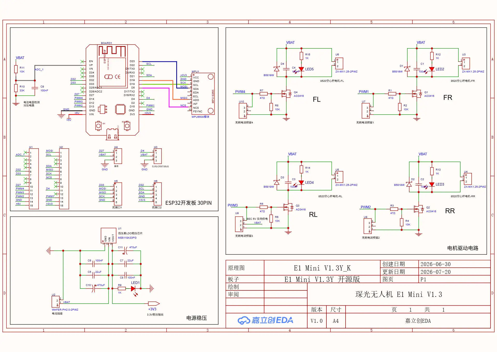
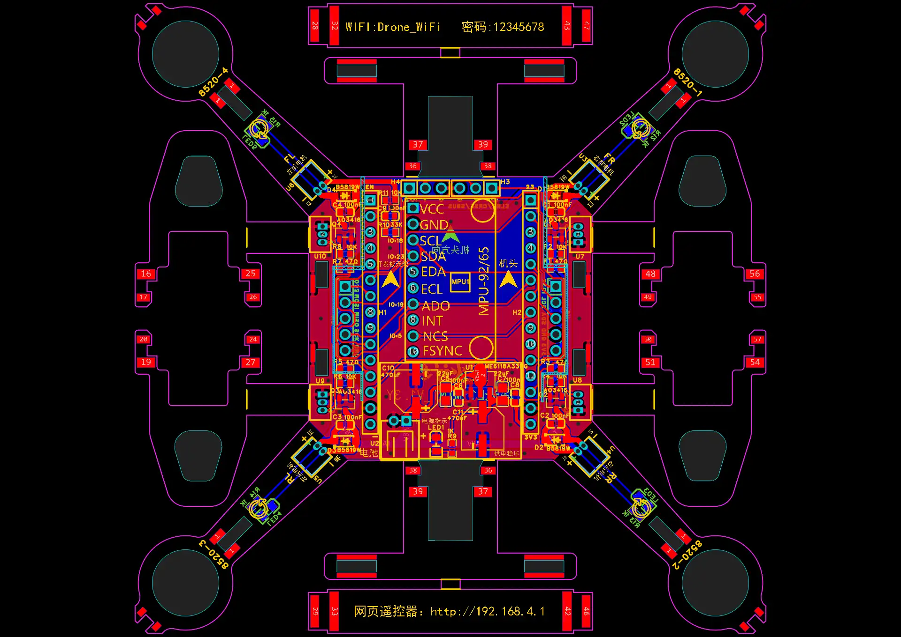

# E1 Mini hardware

Schematic and PCB of the E1 Mini, the mini quadcopter kit sold as "ESP32 Drone"
that this firmware supports as board `TARGET_E1_MINI` (see
[docs/e1-mini.md](../../docs/e1-mini.md)). Its open hardware design is the origin
of the ESP32 drone kits on AliExpress.

- **Creator:** songge8 on OSHWHub
- **Source:** <https://oshwhub.com/songge8/project_qqqyfdkm>
  (design version V1.3, updated 2026-07-20)
- **License:** [CC BY-NC-SA 4.0](https://creativecommons.org/licenses/by-nc-sa/4.0/).
  You may share and adapt it for non-commercial purposes, with attribution and
  under the same license. **No commercial use:** do not make or sell boards from
  it.
- **Changes:** none. These are unchanged screenshots of the online editor. The
  title block shows the vendor's brand name.

This folder is a separate work under its own license, see
[LICENSE.md](LICENSE.md). The rest of the repository (firmware, tools,
documentation) is under GPL-3.0.

## Schematic

- **Top left:** ESP32 DevKit (30 pins) and the MPU6500 module on SPI: SCK GPIO18, MOSI
  GPIO23, MISO GPIO19, NCS GPIO5. The interrupt pin is not connected. Battery
  voltage through 10 kΩ / 33 kΩ to GPIO36.
- **Right:** four motor drivers. PWM GPIO15 (FR), GPIO13 (RR), GPIO12 (RL) and
  GPIO14 (FL) switch an AO3416 MOSFET each, with a B5819W flyback diode, a
  100 nF capacitor and an LED. Each driver has a 3-pin header reserved for a
  brushless ESC.
- **Bottom left:** the PH2.0 battery socket (pin 1 = VBAT) feeds the ME6118A33
  regulator for the 3.3 V rail, with 2 × 470 µF buffer capacitors. There is no
  charging circuit.
- **Expansion headers:** receiver (ELRS/CRSF/SBUS) on GPIO4, a spare header on
  GPIO27, SPI with CS GPIO33, and I2C (GPIO21/22) with GPIO32.

## PCB

The frame is the PCB itself: four arms with the 8520 motors and a break-off
battery holder (the numbered pieces). The ESP32 DevKit plugs into the two
15-pin headers in the middle, and the MPU6500 module sits between them. The
silkscreen carries the factory firmware's Wi-Fi name and password and the
address of its web remote.

## Design files

The EasyEDA Pro project itself opens on OSHWHub / LCEDA only, and logging in
there needs WeChat or a Chinese phone number. The project page also offers the
parts list, an STL for a propeller guard and the factory firmware.

The original ESP-Drone hardware from Espressif (ESP32-S2-Drone, flow deck,
ESPlane) is in the other folders of [hardware/](..).
